# Lab6Web - JavaScript DOM dan Event Handling

**Nama:** Naifah Alya Kamilah

**NIM:** 312510193

**Kelas:** I251B

**Mata Kuliah:** Pemrograman Web (Praktikum 6, Pertemuan 7)

## Tujuan Praktikum

1. Memahami DOM sebagai representasi dokumen HTML yang dapat diakses melalui JavaScript.
2. Memilih elemen HTML menggunakan `id`, `class`, dan selector CSS.
3. Mengubah teks, atribut, class CSS, dan gaya elemen melalui JavaScript.
4. Menangani event pengguna menggunakan `addEventListener()`.
5. Membuat validasi form dan menampilkan pesan sesuai kondisi input.
6. Mengembangkan halaman interaktif dengan minimal tiga fungsi yang berjalan benar.

## Struktur File

```
lab6_dom_event/
├── index.html          # Halaman Latihan 1-6
├── style.css           # Gaya Latihan 1-6
├── script.js           # Logika DOM dan event Latihan 1-6
├── README.md           # Dokumentasi
├── screenshot/         # Screenshot hasil praktikum
└── mini_project/       # Mini Project: Form Pendaftaran Workshop
    ├── index.html
    ├── style.css
    └── script.js
```

## Cara Menjalankan

1. Clone atau unduh repository ini.
2. Buka folder `lab6_dom_event` di Visual Studio Code.
3. Untuk Latihan 1-6, buka `index.html` di browser (klik dua kali atau gunakan Live Server).
4. Untuk Mini Project, buka `mini_project/index.html` di browser.
5. Tekan **F12** lalu pilih tab **Console** untuk memeriksa apabila ada error.

Halaman membutuhkan koneksi internet hanya untuk font Inter pada Mini Project. Tanpa internet, tampilan memakai font Arial dan fungsinya tetap berjalan.

## Langkah Kerja

Pada seluruh file HTML, JavaScript dihubungkan dengan `<script src="script.js" defer></script>` sehingga kode berjalan setelah HTML selesai diparsing.

### Latihan 1 - Mengubah Teks dengan DOM

Elemen dipilih dengan `document.getElementById()`, lalu isinya diubah melalui `textContent`. Judul berubah menjadi "Belajar JavaScript DOM" dan paragraf diganti dengan kalimat sendiri.

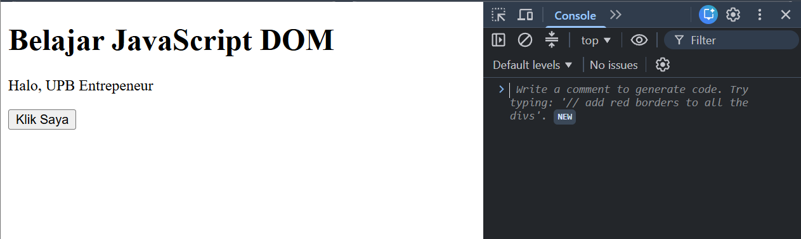

### Latihan 2 - Event Click

Tombol "Klik Saya" diberi `addEventListener("click", ...)`. Setiap kali diklik, paragraf menampilkan waktu saat tombol ditekan menggunakan `new Date().toLocaleTimeString()`.

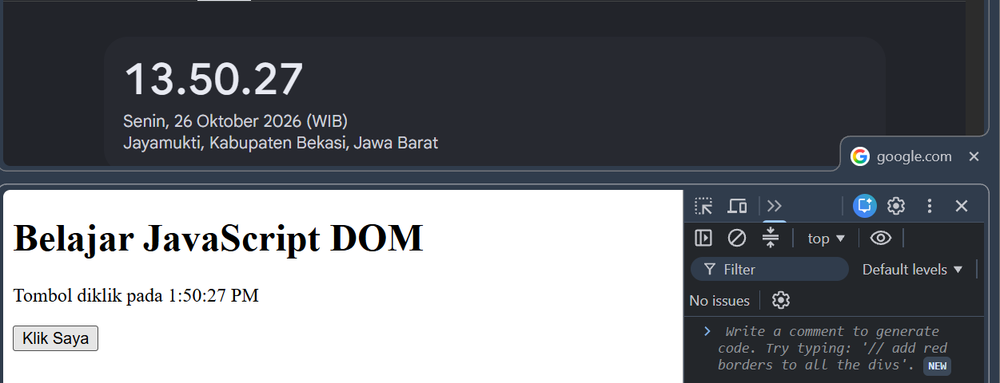

### Latihan 3 - Mengubah Class dan Gaya CSS

Tombol "Ganti Gaya" memakai `classList.toggle()` untuk menambah atau menghapus class `highlight` dan `teks-besar` pada paragraf. Klik pertama mengubah tampilan, klik berikutnya mengembalikannya.

| Sebelum diklik | Sesudah diklik |
|---|---|
| 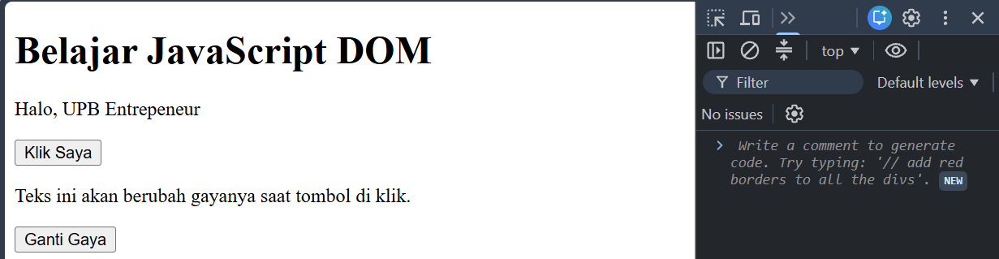 | 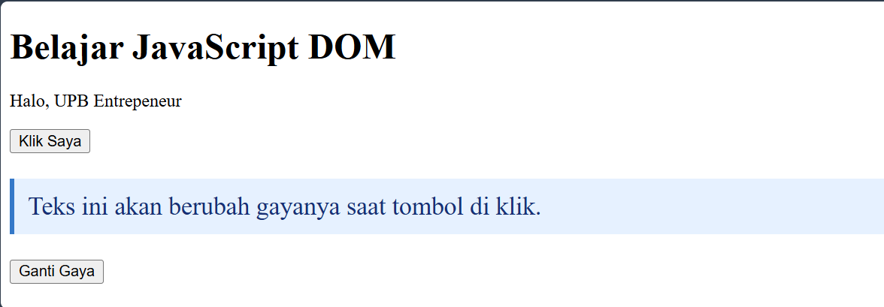 |

### Latihan 4 - Event Input dan Penghitung Karakter

Event `input` pada kolom nama memperbarui jumlah karakter setiap kali pengguna mengetik, menghapus, atau menempelkan teks. Kolom dibatasi `maxlength="40"`.

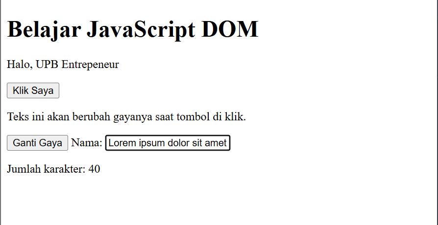

### Latihan 5 - Validasi Form Pendaftaran

Event `submit` memakai `event.preventDefault()` agar halaman tidak dimuat ulang, kemudian nama, email, dan usia diperiksa secara berurutan dengan `if / else if`. Pengujian dilakukan pada lima kondisi:

| Kondisi | Hasil | Screenshot |
|---|---|---|
| Semua kosong | Nama wajib diisi. | 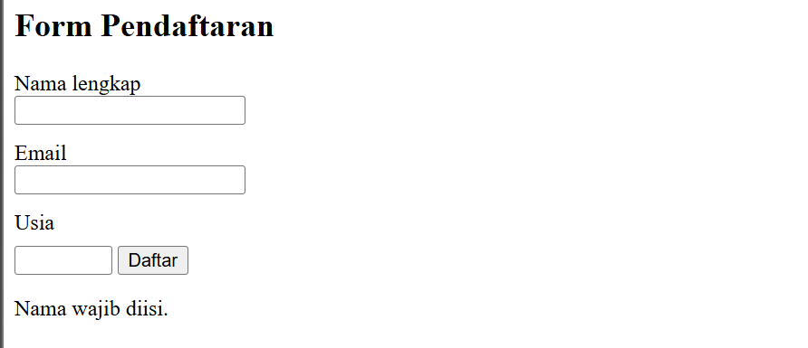 |
| Email kosong / tidak valid | Masukkan email yang valid. | 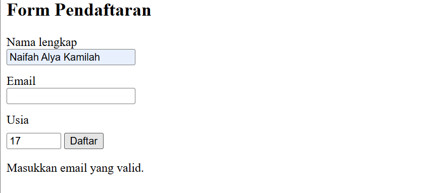 |
| Usia di bawah 17 | Usia harus berupa bilangan bulat 17-100. | 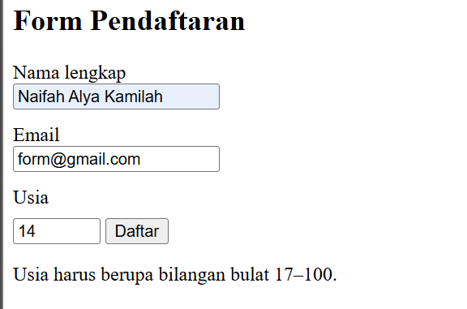 |
| Nama kurang dari 3 karakter | Nama minimal 3 karakter. | 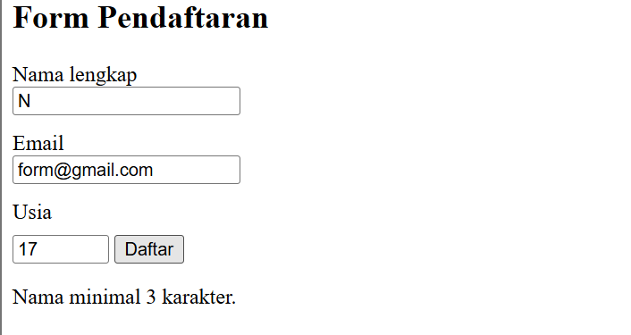 |
| Semua valid | Validasi berhasil. Form siap diproses. | 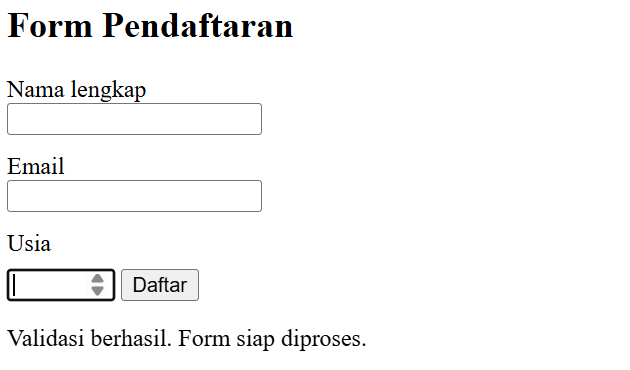 |

### Latihan 6 - Daftar Tugas (To-do List)

Tombol "Tambah" membuat elemen `<li>` baru dengan `document.createElement()` dan memasangnya ke `<ul>` memakai `appendChild()`. Setiap tugas memiliki tombol **Tandai selesai** (toggle class `selesai` sehingga teks tercoret) dan tombol **Hapus** (`item.remove()`). Teks tugas ditampilkan dengan `textContent` agar input pengguna diperlakukan sebagai teks biasa, bukan markup HTML.

| Input kosong | Tugas ditambahkan dan ditandai selesai |
|---|---|
| 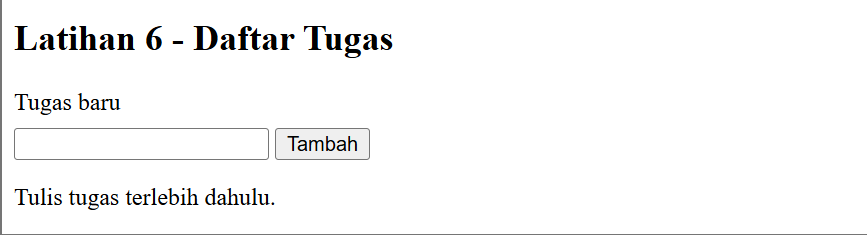 | 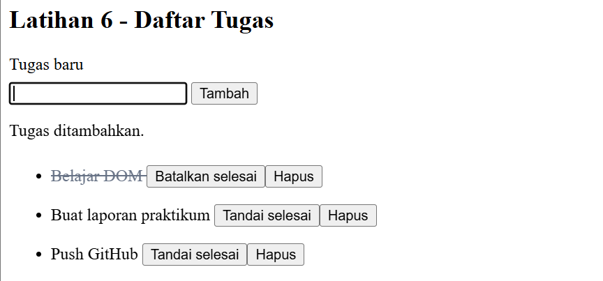 |

## Mini Project - Form Pendaftaran Workshop

Folder `mini_project/` berisi halaman pendaftaran workshop yang terdiri dari `index.html`, `style.css`, dan `script.js`. Tampilannya responsif untuk desktop maupun perangkat mobile.

Fitur interaktif:

1. **Validasi form** (event `submit`): nama minimal 3 karakter, format email valid, dan sesi wajib dipilih. Pesan kesalahan tampil merah di bawah kolom yang bermasalah.
2. **Penghitung karakter** (event `input`): jumlah karakter catatan diperbarui langsung (maksimal 100).
3. **Info sesi** (event `change`): sesi yang dipilih pada dropdown langsung ditampilkan.
4. **Pesan sukses dan kartu ringkasan**: setelah validasi berhasil, tampil pesan hijau dan kartu berisi data pendaftar.
5. **Daftar peserta**: setiap pendaftar ditambahkan sebagai elemen baru lewat `createElement()`, dilengkapi tombol **Hapus** (event `click`).
6. **Kuota sesi**: tiap sesi hanya 1 kursi. Sesi yang sudah diambil menjadi "penuh" dan tidak bisa dipilih, lalu terbuka lagi apabila pesertanya dihapus.

| Pendaftaran gagal | Pengisian form |
|---|---|
| 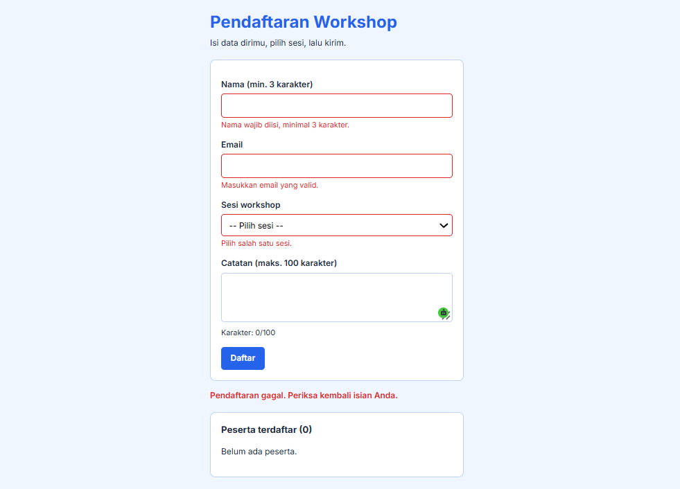 | 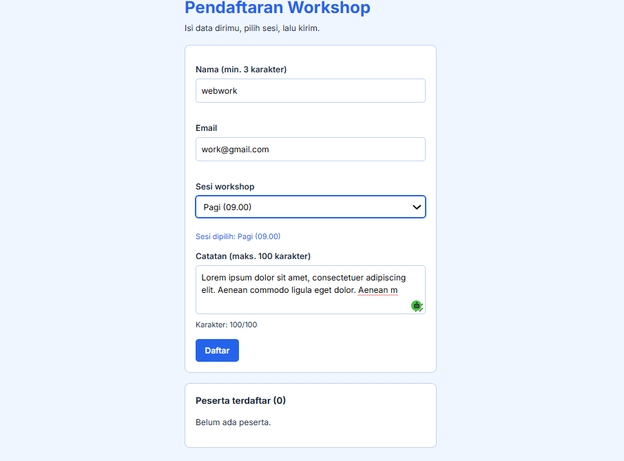 |

**Pendaftaran berhasil** (dropdown memperlihatkan sesi yang sudah penuh):

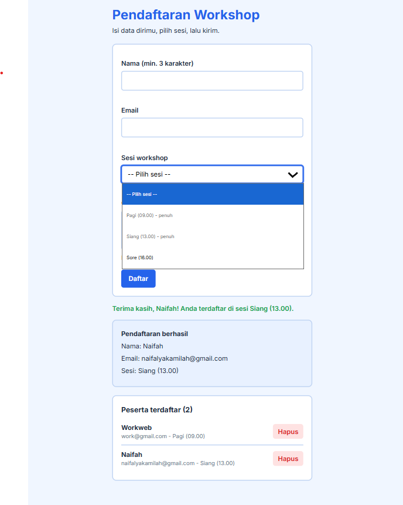

## Eksperimen Mandiri

| No | Eksperimen | Keterangan |
|---|---|---|
| 1 | Tombol hapus satu item pada To-do List | Dikerjakan pada Latihan 6 (tombol **Hapus**) |
| 2 | Nama minimal tiga karakter | Dikerjakan pada Latihan 5 dan Mini Project |
| 3 | Event `change` pada dropdown sesi | Dikerjakan pada Mini Project (info sesi) |
| 5 | Script tanpa `defer` di `<head>` | Lihat penjelasan di bawah |

**Penjelasan eksperimen 5.** Apabila `<script>` diletakkan di `<head>` tanpa atribut `defer`, browser langsung menjalankan JavaScript sebelum elemen pada `<body>` selesai dibuat. Akibatnya `document.getElementById("judul")` mengembalikan `null`, dan baris berikutnya yang memakai elemen itu menimbulkan error `Cannot read properties of null` atau `Cannot set properties of null`. Dengan `defer`, skrip baru dijalankan setelah seluruh HTML selesai diparsing sehingga semua elemen sudah tersedia.

## Jawaban Pertanyaan Evaluasi

Jawaban pertanyaan evaluasi (nomor 1-7) tersedia pada file PDF `Jawaban_Praktikum_6_JavaScript_DOM_Event_Handling.pdf`.
